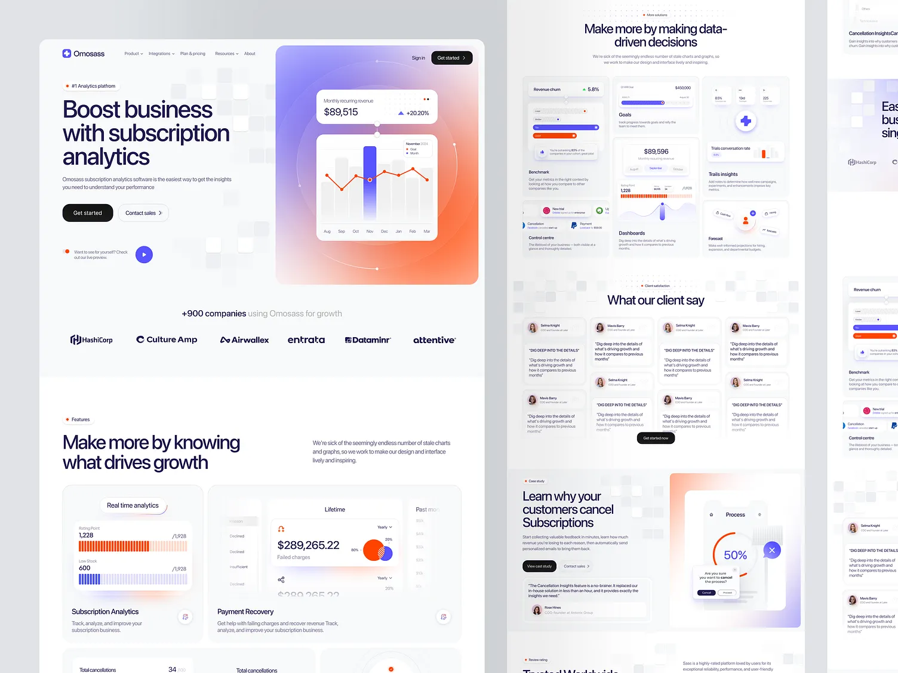
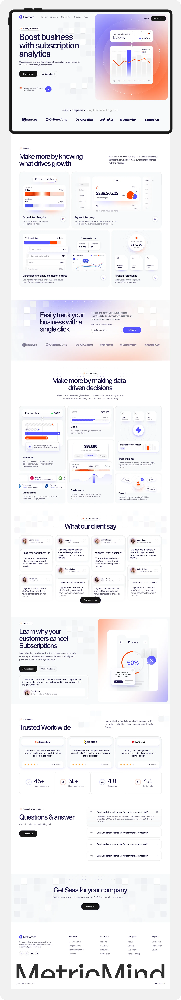

# ⚡ Brightloop — Subscription & Billing Workspace

A modern, high-performance **Subscription & Billing Management System** built with **Next.js 15**, **React 18**, **TypeScript**, **Tailwind CSS**, and a **NestJS** backend. Brightloop gives SaaS businesses full control over recurring billing, invoice generation, customer portals, and real-time revenue analytics.

---

## 📸 Screenshots & Showcase

### 🚀 Hero & Platform Overview


<br/>

### 📊 Full Analytics & Subscription Dashboard


<br/>

### 💼 Management & Billing Workflow


---

## ✨ Key Features

- **📊 Comprehensive Financial Dashboard**: Track MRR, ARR, churn rate, active subscriptions, and overdue balances with interactive Recharts visualizations.
- **🔄 Subscription Lifecycle Management**: Manage plans, discounts, quotas, and state transitions (`Draft` → `Quotation` → `Confirmed` → `Active` → `Closed`).
- **⚡ Automated Billing Engine**: Scheduled catch-up billing runs, currency-safe integer calculations, automated tax handling, and BullMQ background workers.
- **📄 Invoicing & PDF Generation**: Real-time downloadable PDF invoice generation streamed via `pdfkit`.
- **💳 Payment Processing**: Multi-currency support, payment recording, partial payments, and overpayment safeguards.
- **🔐 Role-Based Access Control (RBAC)**: Secure NextAuth and JWT credential sessions with dedicated workspaces for **Admin**, **Staff**, and **Customer** portals.
- **🚀 Zero-Setup Local Development**: Comes with an embedded in-memory PostgreSQL engine (`pg-mem`) pre-seeded with sample data, as well as full production PostgreSQL support.

---

## 🛠️ Tech Stack

| Layer | Technologies |
| --- | --- |
| **Frontend** | [Next.js 15](https://nextjs.org/) (App Router), [React 18](https://react.dev/), [TypeScript](https://www.typescriptlang.org/) |
| **Styling & UI** | [Tailwind CSS](https://tailwindcss.com/), [Radix UI](https://www.radix-ui.com/), [Lucide Icons](https://lucide.dev/) |
| **Charts** | [Recharts](https://recharts.org/) |
| **Backend API** | [NestJS](https://nestjs.com/) / [Express](https://expressjs.com/), [TypeScript](https://www.typescriptlang.org/) |
| **Database** | [PostgreSQL](https://www.postgresql.org/) & [`pg-mem`](https://github.com/oguimbal/pg-mem) (in-memory dev) |
| **Authentication** | [NextAuth.js](https://next-auth.js.org/) & JWT Session Tokens |
| **PDF Generation** | [PDFKit](https://pdfkit.org/) |

---

## 📁 Project Structure

```text
Brightloop/
├── app/                  # Next.js App Router (Admin, Staff, Customer Portal, Auth)
│   ├── admin/            # Administrator workspace
│   ├── api/auth/         # NextAuth credential authentication routes
│   ├── login/            # Authentication & sign-in page
│   ├── portal/           # Customer self-service portal
│   ├── staff/            # Operations & support workspace
│   ├── globals.css       # Tailwind styles & theme variables
│   └── page.tsx          # Public landing page
├── backend/              # Standalone NestJS API server
│   ├── database/         # PostgreSQL schema & migration scripts
│   ├── scripts/          # E2E integration test suite
│   ├── server/           # Database layer, domain models, controllers
│   ├── package.json      # Backend dependencies
│   └── tsconfig.json     # Backend TypeScript configuration
├── components/           # Reusable UI components & dialogs
│   ├── auth.tsx          # Authentication cards & form inputs
│   ├── bl-shared.tsx     # Animated counters, SVG icons, and hero panels
│   ├── charts.tsx        # Recharts wrappers (revenue & metrics)
│   ├── forms.tsx         # Entity creation & edit modals
│   ├── landing.tsx       # Landing page interactive sections
│   └── workspace.tsx     # Core data tables, filters, and actions
├── public/               # Public assets & screenshots
│   ├── landing-hero.webp # Hero section screenshot
│   ├── landing-full.webp # Workspace dashboard screenshot
│   └── landing-full2.webp# Secondary dashboard preview
├── .env.example          # Frontend environment variables template
├── next.config.mjs       # Next.js config with API proxy rewrites
├── tailwind.config.js    # Tailwind styling configuration
└── package.json          # Root frontend dependencies & dev scripts
```

---

## 🚀 Quick Start Guide

### 1. Prerequisites
- **Node.js**: v22.0.0 or higher
- **npm** or **pnpm** / **yarn**

### 2. Installation

Clone the repository and install dependencies:

```bash
git clone https://github.com/Master1109/Brightloop.git
cd Brightloop

# Install root/frontend dependencies
npm install

# Install backend dependencies
cd backend && npm install && cd ..
```

### 3. Environment Configuration

Create a `.env` file in the root directory:

```bash
cp .env.example .env
```

*(On Windows PowerShell: `Copy-Item .env.example .env`)*

Configure your environment variables:

```env
# NextAuth
NEXTAUTH_SECRET=your-random-64-character-secret
NEXTAUTH_URL=http://localhost:3000

# Backend URL proxy
BACKEND_URL=http://127.0.0.1:4000
NEXT_PUBLIC_API_URL=http://localhost:4000
```

### 4. Running the Development Server

Start both the frontend and backend servers:

```bash
# Terminal 1: Start Next.js Frontend (Port 3000)
npm run dev

# Terminal 2: Start Backend API (Port 4000)
cd backend
npm run dev
```

Open [http://localhost:3000](http://localhost:3000) in your browser.

> 💡 **Note**: By default, the backend runs using `pg-mem` (an in-memory PostgreSQL engine) and automatically seeds mock customers, subscriptions, and financial records. No external database setup is needed to start testing immediately!

---

## 👥 Default Demo Credentials

When running in development mode, the following test accounts are pre-seeded:

| Portal | Email | Password | Role / Access |
| --- | --- | --- | --- |
| **Admin Workspace** | `admin@brightloop.local` | `Brightloop!2026` | Full system settings, billing runs, catalogs |
| **Staff Portal** | `staff@brightloop.local` | `Brightloop!2026` | Subscriptions, customer management, invoices |
| **Customer Portal** | `customer@brightloop.local` | `Brightloop!2026` | View personal plans, invoices, and payment history |

---

## 🧪 Available Scripts

| Command | Description |
| --- | --- |
| `npm run dev` | Starts the Next.js development server on port 3000 |
| `npm run build` | Builds the optimized production application |
| `npm run start` | Runs the production build server |
| `npm run typecheck` | Validates TypeScript types across the project |
| `cd backend && npm test` | Executes backend unit tests |
| `cd backend && npm run test:integration` | Runs end-to-end API integration tests |

---

## 📄 License

This project is licensed under private proprietary rights — Brightloop Software.
